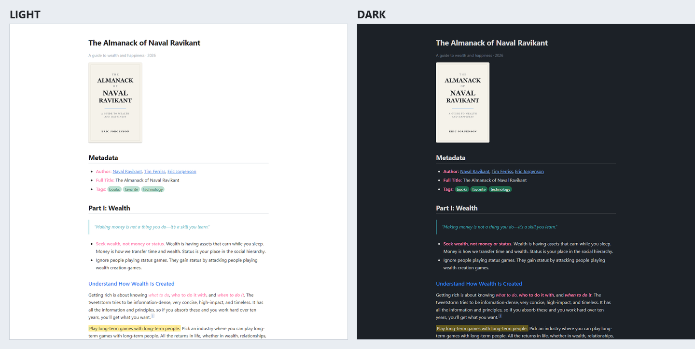

# Things for Typora

把 [Obsidian Things](https://github.com/colineckert/obsidian-things) 主题移植到 Typora。保留 Things 的浅色/深色配色、标题层级、粉色强调、青色引用、One Dark 代码高亮和任务清单，同时按 Typora 的 DOM 与主题变量重写了样式。

这是一个非官方移植版，与 Obsidian Things 作者 Colin Eckert 无关。



[查看浅色完整截图](screenshots/things-light.png) · [查看深色完整截图](screenshots/things-dark.png)

## 特性

- **两套完整主题**：`things-light.css` 与 `things-dark.css`，分别对应 Obsidian Things 的 light / dark 配色。
- **Things 标题体系**：H1/H2 使用正文色，H2 带下划线，H3 蓝色，H4 琥珀色大写，H5 红色，H6 灰色大写。
- **正文强调**：粗体与斜体使用 Things 粉色 `#ff82b2`，引用使用青色 `#3eb4bf` 并带左侧竖线。
- **One Dark 代码**：行内代码、代码块和语法高亮分别处理；等宽字体优先使用内置的 JetBrains Mono。
- **正文宽度**：默认占 Typora 窗口宽度的 70%（`70vw`，侧边栏打开时也是按整个窗口算），由 `--things-content-width` 控制。侧边栏固定时会自动向左偏移，使正文相对整个窗口居中；窗口过窄时不会压到侧边栏。
- **Typora 细节**：任务复选框、标签胶囊、图片卡片、表格斑马纹、脚注、TOC、YAML front matter、搜索高亮、专注模式、侧边栏与菜单配色。
- **打印友好**：从深色主题导出 PDF 时自动切换为浅色页面，代码块与表格背景会保留。
- **无依赖**：主题是纯 CSS；内置字体只是可选项，不复制 `things/` 文件夹也能正常工作。

## 安装

### Windows 一键安装

在仓库根目录运行：

```powershell
powershell -ExecutionPolicy Bypass -File .\install.ps1
```

脚本会把两个 CSS 文件和 `things/` 字体文件夹复制到 `%APPDATA%\Typora\themes`，已存在的同名文件会先备份为 `.bak`。然后重启 Typora，在「主题」菜单中选择 **things-light** 或 **things-dark**。

### 手动安装

1. 打开 Typora 的主题文件夹：
   - Windows：`%APPDATA%\Typora\themes`
   - macOS：`~/Library/Application Support/Typora/themes`
   - Linux：`~/.config/Typora/themes`
2. 把 `themes/things-light.css`、`themes/things-dark.css` 和整个 `themes/things/` 文件夹复制进去。
3. 重启 Typora（或在「偏好设置 → 外观 → 打开主题文件夹」后重新打开菜单）。
4. 在「主题」菜单中选择 **things-light** / **things-dark**。

> 只复制两个 `.css` 文件也能用；`things/` 只包含 JetBrains Mono 字体。缺少字体时会回退到 Cascadia Code、Consolas 等系统等宽字体。

### 让 Typora 同时使用浅色和深色

Typora 的浅色/深色主题是分开选择的：在「偏好设置 → 外观」中把浅色主题设为 `things-light`，深色主题设为 `things-dark`。之后切换 Typora 的外观模式即可。

## 与 Obsidian 版的差异

Typora 和 Obsidian 的渲染结构不同，因此这不是像素级复刻：

- 没有 Obsidian 的 Style Settings 插件。颜色、字号等可以直接改 CSS 顶部的变量（见下文）。
- Obsidian 的自定义 `data-task` 复选框（`[/]`、`[!]`、`[?]` 等）在 Typora 中不会变成图标；Typora 只支持标准的 `- [ ]` / `- [x]`，这里为它们做了 Things 风格的圆角复选框。
- Obsidian 的「fancy code block」行号、代码块语言标签悬浮按钮等依赖 Obsidian 的 CodeMirror 结构，Typora 中不适用；代码块保留圆角、背景和 One Dark 高亮。
- 移动端浮动按钮、Kanban、Todoist 等插件样式没有移植。
- Obsidian 的 tag 是真实语法；Typora 中只有部分场景会出现 `.md-tag`，主题仍提供了绿色胶囊样式。

## 自定义

每个生成后的 CSS 顶部都有一整段 `:root` 变量，改这里最直接：

```css
:root {
  --things-accent: #4c8ce6;   /* 链接、选中、复选框 */
  --things-pink: #ff82b2;     /* 粗体、斜体 */
  --things-quote: #3eb4bf;    /* 引用文字 */
  --things-code-block-bg: #f0f2f5;
  --things-content-width: 70vw; /* 正文宽度（相对整个窗口） */
  --things-font-text: ...;
}
```

如果改了 `src/tokens-*.css` 或 `src/base.css`，重新生成：

```powershell
node build.mjs
```

不要直接改 `themes/*.css` 后再运行构建，构建会覆盖它们。

> `--things-content-width: 70vw` 以整个 Typora 窗口为基准；如果你更想按编辑区（窗口减去侧边栏）计算，把它改成 `70%`。窄窗口和打印时仍会自动回退到可读宽度。

## 目录结构

```
.
├─ themes/
│  ├─ things-light.css      # 可直接安装的浅色主题
│  ├─ things-dark.css       # 可直接安装的深色主题
│  └─ things/               # JetBrains Mono 字体与 OFL 许可证
├─ src/
│  ├─ tokens-light.css      # 浅色调色板与 Typora 变量映射
│  ├─ tokens-dark.css       # 深色调色板与 Typora 变量映射
│  └─ base.css              # 共用排版、代码、表格、界面与打印样式
├─ preview/                 # 维护者用的静态预览页
├─ screenshots/
├─ build.mjs
├─ install.ps1
└─ LICENSE
```

## 致谢

- [Obsidian Things](https://github.com/colineckert/obsidian-things) — Colin Eckert，本移植的配色、字体与视觉规则来源。
- [Minimal](https://github.com/kepano/obsidian-minimal) — Stephan Ango（@kepano），Things 的早期基础，也是本仓库上游 LICENSE 的版权来源。
- [JetBrains Mono](https://www.jetbrains.com/lp/mono/) — JetBrains，SIL Open Font License 1.1。

## License

MIT。详见 [LICENSE](LICENSE)。上游 Obsidian Things 与其基础 Minimal 的版权声明已保留在 LICENSE 中。
