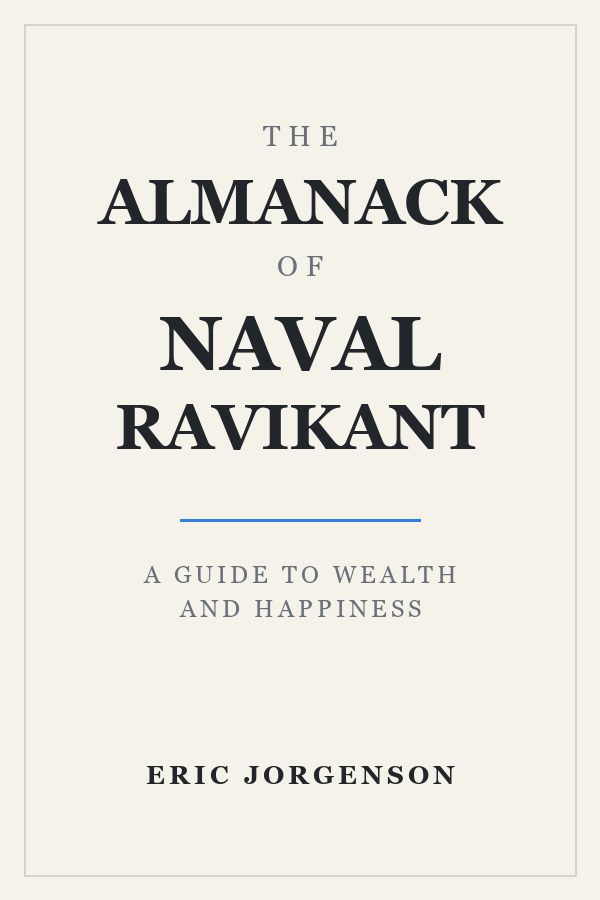

# The Almanack of Naval Ravikant

A guide to wealth and happiness · 2026



## Metadata

- **Author:** [Naval Ravikant](#), [Tim Ferriss](#), [Eric Jorgenson](#)
- **Full Title:** The Almanack of Naval Ravikant
- **Tags:** `books` `favorite` `technology`

## Part I: Wealth

> “Making money is not a thing you do—it’s a skill you learn.”

- **Seek wealth, not money or status.** Wealth is having assets that earn while you sleep. Money is how we transfer time and wealth. Status is your place in the social hierarchy.
- Ignore people playing status games. They gain status by attacking people playing wealth creation games.

### Understand How Wealth Is Created

Getting rich is about knowing _what to do_, **who to do it with**, and **_when to do it_**. The tweetstorm tries to be information-dense, very concise, high-impact, and timeless. It has all the information and principles, so if you absorb these and you work hard over ten years, you’ll get what you want.[^1]

==Play long-term games with long-term people.== Pick an industry where you can play long-term games with long-term people.

#### Specific Knowledge

Specific knowledge is found by pursuing your genuine curiosity and passion rather than whatever is hot right now.

##### Judgment

Leverage is a force multiplier for your judgment. Code and media are permissionless leverage — they work while you sleep.

###### Accountability

Embrace accountability and take business risks under your own name.

## A Small TypeScript Example

```ts
type Leverage = "code" | "media";

const build = (kind: Leverage) => {
  // Permissionless leverage, compounded daily.
  return kind === "code" ? 24 : 24;
};
```

## Reading Notes

| Idea | Leverage | Compounds? |
| --- | --- | --- |
| Specific knowledge | High | Yes |
| Code & media | Permissionless | Yes |
| Status games | Zero-sum | No |

- [x] Read the whole book
- [x] Build a small product in public
- [ ] Write one page every morning

---

中文排版检查：财富不是零和游戏，代码与媒体的杠杆会在你睡觉时继续工作。

[^1]: A footnote rendered with the Things palette.
